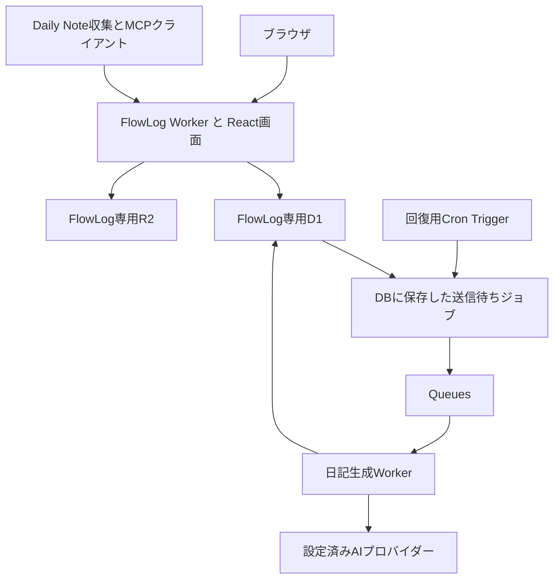

# FlowLog の Cloudflare 移行計画

## 本番切り替え工程へ移行（2026-10-29）

利用者の検証環境の受け入れと「データ移行およびDNS設定」の依頼に基づき、本番の専用インフラへのコピー、旧環境の書き込み停止、復元検証、DNS・配信先切り替えを実施した。Googleログインと既存API認証での読み取りを確認している。画像の参照移行には、FlowLogのブロック・保存済みAI本文に加え、Daily Note本文、再投影元、今後の取得スクリプトを含める。

現在の実施結果と継続項目は [本番移行の記録](cloudflare-production.md) にまとめる。以下の「本番・DNSは未変更」「今回は実施しない」は、それぞれ計画・隔離工程を実施した時点の範囲を示す履歴であり、本番工程の現在の状態ではない。mainを含めGitHubへpushしない条件は引き続き維持する。

2026年10月29日時点の計画。Reactの画面を維持し、アプリの実行、DB、画像保存、認証、日記生成ジョブをCloudflareへ移す。移行先は既存のkanouk.comを管理しているCloudflareアカウントとし、FlowLog専用のWorker・D1・R2を追加する。

作業は「アプリとインフラ」「ユーザーとデータ」「ドメインと利用先」の3系統に分ける。先にCloudflareの隔離環境でアプリを完成させ、データ移行をリハーサルし、最後に書き込みを停止して本番データと接続先を切り替える。

## 隔離環境の実装進捗（2026-10-29）

元のReact画面と11個のEdge Functionを専用Workerへ移植・配備した。D1/R2のコピー照合、REST/MCP、写真CAS、AI・外部連携の模擬接続、実Queueから架空の日記と採点を生成して保存する処理まで確認した。詳細は [隔離環境の記録](cloudflare-staging.md) と [機能ごとの移植状態](cloudflare-functions.md) に記録する。

Googleログインは追加実装し、利用者の承認で検証専用OAuthクライアントを新規作成した。専用Workerへ設定し、本人のGoogle認証から画面へ戻り、既存所有者UUIDのsessionが作られることを確認した。既存OAuthクライアントは変更していない。Firecrawlキーを設定し、実取得・要約・保存を確認した。404だったモデル名2件は提供元のAPI一覧・公式資料と生成試験に基づき、検証環境だけで `gpt-6-luna` と `gemini-3.5-flash-lite` へ修正した。採点は利用者の指定で日記と同じモデルに設定し、実際の採点保存も確認した。設定を推測で置き換えず、コードの移植と実サービスでの受け入れを分ける。

利用者の依頼で、2026-10-29 22:27 JSTから隔離環境の自動生成を新規記録だけに限定して有効にした。有効化時点の既存日記・既存記録の生活日を保護し、DBへの追加時に登録した新しい出来事だけを入力へ使う。架空記録の追加から自動生成・採点保存・画面更新まで確認した。コピーした過去の日記は再生成しない。

本番・DNS・Lovable・実クライアントは変更せず、mainを含めGitHubへpushしていない。調査原本は取得時の内容のまま非公開に保持する。以下の調査・計画段階の記述と、上記の実装進捗を区別する。

## 今回確定した方針

隔離環境の基本機能を実装し、データ照合と動作試験まで完了した。結果と未実施範囲は [隔離環境の実装記録](cloudflare-staging.md) にまとめる。以下の「今回の更新」は計画策定時の範囲を示し、隔離環境の実装・配備はその後の利用者の依頼に基づいて実施した。本番・DNSは引き続き変更していない。

2026年10月29日のレビューを受け、次の方針を確定した。この更新は計画書とIssue #12への反映に限り、本番・DNSの変更や移行の実行は行わない。

- Lovable側の新しい日記機能の配備を凍結する。日記用SQLの適用、api・diary-worker・format-entriesの関連配備、pg_cron・pg_net・Vaultの準備、新しいフロントの公開は進めない。日記ジョブはCloudflareで実装・検証する。
- 本人の既存所有者UUIDを維持し、新環境では初回パスワード再設定を必須にする。旧パスワードhashの移植・互換性調査は実施しない。新規登録と匿名ログインはサーバー側で無効にする。
- 調査記録の原本はローカルに保全し、Gitの追跡対象から外す。公開する計画書とIssueには、移行判断に必要な要約だけを載せる。
- 本番データ移行、パスワード再設定メールの送信、配備、DNS変更、Lovable連携解除は後続工程の作業とし、今回は実施しない。

## 当面の実施範囲：Cloudflareの隔離環境で動かす

当面の到達点は、GitHubのソースをWorkers向けに移植し、コピーしたデータと画像を使って、本人だけがアクセスできるCloudflareの隔離環境で動作を確認することとする。本番切り替えの未決事項をすべて解消する前に、この範囲を先行できる。今回の追記は作業範囲と手順を定めるもので、環境構築や移植が完了したことを示さない。

### 作業ブランチで実装し、mainへpushしない

- GitHubの取得元コミットを記録し、実装開始前に `codex/` 配下の作業ブランチを作る。既存の未コミット変更を保全し、必要なら専用の作業ディレクトリへ分ける。
- ソースの移植・検証設定・配備処理の変更は作業ブランチで行う。mainおよびLovableの同期対象ブランチにはpush・マージせず、同期ブランチを検証用ブランチへ変更しない。
- GitHub Actionsを使う場合も、対象はstagingだけに固定する。本番への配備処理を起動しない。

### 検証用URLだけを使い、本人だけに公開する

- FlowLog専用のstaging Worker・D1・R2・Queueを用意し、配備前に対象アカウントとbindingsを照合する。既存サイトや本番のリソースは共用しない。
- 独自ドメインやDNSを変更せずに使える検証用URLで動かす。`flowlog.jp`・既存サイトのroute・Custom Domain・DNSレコード・ネームサーバーを変更しない。
- 個人データを入れる前に本人だけがアクセスできる保護を設定する。未認証・別アカウントから画面・API・画像を取得できないことを、別の配備URLやpreview経由も含めて確認する。R2は非公開にする。

### 自動ジョブと外部連携は、本番へ書き込めない状態から始める

- 旧環境のデータと画像は読み取り/exportでコピーし、元の記録・画像・設定を更新・削除しない。取り込み時はジョブを作らず、既存日記を再生成しない。
- Cron、Queueの送信・消費、日記自動生成、Raindrop同期、Gyazoの更新・削除、メール送信等は初期状態で停止する。本番用の認証情報や連携先を検証設定へそのまま流用せず、ブラウザ・API・MCPも隔離環境だけを参照する。
- 最初は架空データで保存・編集・再送・競合を確認し、その後にコピーした本人データの閲覧・照合を行う。更新試験では隔離環境のコピーだけを変更する。
- ジョブ・外部連携の試験は、検証用の接続先またはモックを使って個別に有効化する。本番への書き込みや削除、実在の相手への送信が起こらないことを確認し、未設定の機能は停止状態のまま残す。

隔離環境の完了条件は、本人のログイン、コピーした記録・画像の表示、隔離DBへの保存・読み戻しが確認でき、本番のデータ・設定・DNS・外部クライアントを変更していないことである。日記ジョブや外部連携の検証結果は機能ごとに残し、未検証を成功と扱わない。本番の書き込み停止、最終同期、DNS変更、利用先の切り替え、Lovable連携解除は後続工程に残す。

## 調査で確認した現状

調査記録の原本は `docs/migration/survey-2026-10-29.json` としてローカルに保全し、`.gitignore` で除外する。内部リソース名、バックエンドURL、Private Vaultの絶対パス等を含むため、原本やそのコピーをリポジトリ・Issueへ掲載しない。公開版から原本へのリンクも設けない。

初回調査ではローカルmain・GitHub main・Lovableのコードが `45751f709d08f2f96a56403281b879f231e42231` で一致した。原本には当時のコミットと取得時刻を残し、後の確認で上書きしない。レビューで再確認したローカルmain・GitHub mainは `a669daedf0deb5391fb6112a6b9d7c8662840c0a` であり、以下のソース情報はこの版に合わせた。Lovableの現在のコードと本番DB・API・Cloudflare・DNSは、この更新では再照会していない。

DBの主要件数は2026-10-29 15:40:49 JSTの同一SELECTで取得した過去の調査値である。画像・Storage・Cloudflareの情報は別の読み取りであり、同一トランザクションのスナップショットではない。実装開始時と最終移行時に再確認する。

| 対象 | 確認結果 |
|---|---|
| ソース | レビュー時のローカルmain・GitHub mainは `a669daedf0deb5391fb6112a6b9d7c8662840c0a`。Lovableとの現在の一致は未確認 |
| フロント | Vite 5、React 18、TypeScript、React Query。Supabaseクライアントを参照するアプリ側モジュールは20個 |
| サーバー | Edge Functionsは11入口。`*.test.ts` を除く配下のTypeScriptは5,834行（テスト用DBヘルパー83行を含む）。旧format-entries入口はmainでは410応答へ変更済み |
| DB定義 | Supabase側SQLは43本。Drizzle側は適用済みの写真API用0000の1本。PR #11で未適用の日記用0001・journal項目・snapshotを取り下げ、日記SQL原本はSupabase側に保全済み。対応SQLを二重適用しない |
| 本番DB | publicに13テーブル。合計3,588,096 bytesはPostgreSQLのインデックス等を含む物理サイズであり、D1の移行後サイズではない |
| 本番API | `/health` はHTTP 200。公開OpenAPIは1.1.0 |
| 新しい日記生成 | mainには実装済み。本番にはdiary_generation_control、jobs、historyの3テーブルがなく、pg_cron・pg_netも未導入 |
| ログイン主体 | auth.usersは24件。匿名22件、登録済み2件。移行対象の所有者は1件存在する |
| 全アカウントの記録 | blocks 2,753件、entries 298件。ブロックの所有者は15 ID |
| Gmailアカウントの記録 | blocks 2,716件、entries 272件、APIトークン4件 |
| その他のID | 匿名IDに36ブロック・25エントリー、別の登録IDに1ブロック・1エントリー。別人と断定せず、移行時にも本人のGmail IDへ自動統合しない |
| Gmailアカウントの画像 | 339 URL参照。Gyazo 271件、Supabase Storage 68件。それぞれ重複URLはなかった |
| Storage全体 | 画像用bucketは158オブジェクト、metadata上のサイズ合計462,371,578 bytes。別に非公開の過去DB exportが1オブジェクトある。画像の実ダウンロード・hash照合は未実施 |
| 生活日の設定 | Gmailアカウントの境界はAsia/Tokyoの4時。記録の所属日を一律0時や3時へ変換しない |
| Cloudflare | 本人の対象アカウント向け認証ガードの確認に成功。kanouk.comはactiveで、既存サイトが稼働している。内部リソース名は公開しない |
| 移行先の準備 | 同アカウントのAPI一覧にFlowLog名のWorker・D1・R2はない。flowlog.jpゾーンもない。今回の調査ではリソースを作成していない |
| DNS | flowlog.jpはMuuMuu系、kanouk.comはCloudflareのネームサーバー |

「利用者は本人だけ」という前提と、DBに複数の匿名IDがあることは両立する。移行するIDは、件数だけでなく所有者の対応表で決める。その他のIDは全体バックアップに保全し、本人のものと確認できた場合に別の工程で取り込む。

## 移行先の構成

| 現在の役割 | 移行先 |
|---|---|
| Viteで生成したReact画面 | Workers Static Assets |
| PostgRESTへの直接アクセス、Edge Functions | Honoを使うWorker API。既存APIにもHonoがあるためルーティングを再利用する |
| PostgreSQL | FlowLog専用D1。UUIDは文字列、画像配列・JSONBはJSONまたは子テーブルへ変換する |
| Supabase Auth | D1で動くアプリ認証。Better Authを第一候補とし、メールログイン、ID維持、失効処理を隔離環境で先に検証する |
| Supabase Storage | FlowLog専用R2。アップロード・削除の認可と配信URLはWorkerが扱う |
| 日記ジョブと10秒間隔の起動 | D1の永続ジョブと送信待ち記録、Queues、回復用Cron Trigger |
| サービス用の秘密値 | Worker Secrets。ユーザーが登録したAIキー・外部トークンは暗号化して保存し、復号鍵をSecretsに置く |
| 外部APIとMCP | 同じデータ操作を呼ぶWorkerの入口。本人のAPIトークン認証とMCP OAuthを維持する |

アプリを移しても、OpenAI・Google・Anthropic・Raindrop等の外部サービス利用は残る。LovableのAI Gatewayには移行後の依存を残さない。初回調査時の日記・OCR・URL要約にはユーザー登録のGoogleモデルが割り当てられていた。ただし設定値の取得だけでは、そのモデル名やキーが実APIで利用できるとは確認できない。

レビュー対象のコードでは、日記生成・採点・OCR・URL要約にLovable AI Gatewayへ送る既定経路がある。日記生成・採点・URL要約はモデル設定が揃わない場合に `google/gemini-2.5-flash` を選び、OCRも未設定時に同モデルを選ぶ。採点は有効かつ評価プロンプトがある場合に呼び出される。本番でこの経路を実際に利用したかは未確認である。

移行先では、日記・採点・OCR・URL要約ごとにプロバイダーとモデルを明示する。既存の割当を基本とし、採点等の未設定分は隔離試験までに確定する。設定不足や無効なモデル・キーはエラーまたは未設定として表示し、別モデルへ自動で切り替えない。架空データで実APIの接続と出力を確認し、Lovable Gatewayへの通信がないことを受け入れ条件にする。

D1はPostgreSQLとSQL・型が異なる。[公式の移行仕様](https://developers.cloudflare.com/d1/best-practices/import-export-data/)に従い、既存SQLをD1用に作り直す。データ量には十分余裕がある見込みだが、難所は容量よりも更新の原子性と認証の置換にある。

## アプリとインフラの移植

### 先に成立させる更新処理

本格的な画面移植に入る前に、D1上で次の処理を小さく実装する。架空データを使い、ローカルとCloudflareの隔離D1の両方で確認する。

- 写真APIのPOSTで、ブロック・所属エントリー・冪等キー・初回応答を一緒に確定する。同じキーの再送で再作成せず、異なる入力なら409を返す。
- PATCHで、content・images・occurred_at・entry_id・revisionの期待値を原子的に比較する。競合時は409とし、他のブロックを書き換えない。
- ブロック保存と日記ジョブ作成を同じDB処理に含める。日付移動やeventから別カテゴリへの変更、削除も対象日に反映する。
- 同日ジョブを重複配送しても保存を重複させず、処理中に本文・画像・モデル設定・日記の手編集が変われば古い結果を保存しない。

D1の[batchはSQLトランザクション](https://developers.cloudflare.com/d1/worker-api/d1-database/#batch)として使えるが、既存のPL/pgSQL、SKIP LOCKED、advisory lockをそのまま再現するものではない。条件付きSQL・revision・leaseを使い、比較と更新の間に競合が入らない設計を確認する。ライブラリのtransactionという名前だけで同じ保証があると判断しない。

### 認証と画面の変更

所有者の既存UUIDをアプリの所有者IDとして維持する。認証ライブラリ側で別IDが必要なら、認証IDと既存所有者UUIDを結ぶ固定の対応表を使う。全レコードのuser_idをまとめて書き換える設計は採用しない。

[D1対応が公式に案内されているBetter Auth](https://better-auth.com/blog/1-5)を第一候補にする。使用するバージョンを固定し、その版のD1対応と、Workers上のログイン・ログアウト・session失効・初回パスワード再設定を検証する。本人の登録アカウントだけを事前作成し、新規登録と匿名ログインはサーバー側で無効にする。Gmailアドレスを使うこととGoogle OAuthでログインすることは別であり、Googleログインは利用者の追加要望に従って検証環境へ実装し、実認証まで確認済み。メール・パスワード認証も残す。

既存所有者UUIDに対応する本人アカウントに対し、有効期限と一度限りの使用を備えた再設定手続きを用意する。送信経路、期限切れ・再利用の拒否、再設定前のログイン拒否、再設定後のログインと失効を架空アカウントで確認する。今回の更新ではアカウント作成やメール送信は行わない。

Cloudflare Accessはステージングの保護に利用できる。本番のAPI・MCPを一括してAccessのログイン画面の背後へ置くと既存の機械連携が変わるため、本番はアプリsessionとAPIトークンの入口を明示して認証する。

20個のフロント側モジュールからSupabase SDKへの呼び出しを取り除き、型のあるFlowLog APIへ置き換える。RLSが担っていた所有者の判定は、サーバーが確定したIDで行う。リクエスト本文のuser_idを信用せず、秘密のAPIキーはブラウザへ返さない。認証・個人データの応答はprivate/no-storeとし、kanouk.comのキャッシュ設定を流用しない。

### 機能を移す順序

1. 認証、entries/blocks、タグ、生活日、タスク・予定、検索・集計、画像の保存と表示。
2. 外部REST API、写真APIの冪等性と競合制御、APIトークン管理、MCPとOAuth。
3. AIモデル・キー・プロンプト設定、OCR、URL要約、Raindrop、Gyazo連携。
4. 新しい日記生成の永続ジョブ、状態監視、手動再生成、履歴と復元、採点。

mainの新UIは未導入の日記RPCを参照し、旧format-entries入口も停止する。この状態の新フロントをLovableへ公開しない。Lovable側の日記配備は凍結し、SQLのDDL・初期データ分離による再試行やpg_cron・pg_net・Vaultの導入は進めず、Cloudflare版の画面と対応APIを同じ受け入れ単位で完成させる。直近のLovable作業は、DDL専用ツールが原本SQL中の初期データINSERTを扱えないため、提出前に停止した記録であり、INSERTの実行失敗ではない。日記自動生成の有効化は機能の配備と分け、本人の既存日記を一斉に再生成しない。

### 配備経路とLovable連携

Cloudflare版の配備元はGitHub Actionsからの `wrangler deploy` に統一する計画とし、staging・productionの対象アカウント、bindings、Secretsと実行条件を明示する。本番切り替え前に、Lovableと同期しているブランチ、同期から関数・DB・画面の配備に至る条件を読み取りで確認する。GitHub同期だけで自動配備されるとは断定しない。

旧環境の復元手段を確保し、切り替え準備の一部としてFlowLogプロジェクト単位のLovable Git連携を解除する。ほかのプロジェクトが使うアカウント全体のGitHub連携は変更しない。解除は旧DBの書き込み停止を代替しない。今回は配備設定の作成・実行や連携解除を行わない。

### 日記ジョブの永続化

Queuesへの送信とD1への書き込みは別操作なので、ブロックの保存時に「送信待ち」をD1へ同時保存する。送信担当がQueueへ通知し、未送信やlease切れをCronで拾う。Queuesは[少なくとも1回の配送](https://developers.cloudflare.com/queues/reference/delivery-guarantees/)であり、重複実行を前提にDB側で保存を制御する。

通常は5秒の待機で連続編集をまとめる。回復用Cronは分単位とし、現行SQL案の10秒起動をそのままCloudflare Cronへ置き換えない。[Cronの式は分を最小フィールドとする](https://developers.cloudflare.com/workers/configuration/cron-triggers/)。障害回復時には通常より遅れる可能性を状態画面で扱い、30秒以内の完了を保証しない。

同日1ジョブ、古いleaseの保存拒否、入力・設定・既存日記の再照合、最大3回の試行、所有者と日付ごとの日次上限、直近5版の履歴、停止中の保存拒否を移植する。画面を閉じた後の生成をHTTPのwaitUntilだけへ任せない。LLMの応答待ちに耐えるQueue consumerの実行時間を設定する。AIへの通信が途切れた場合まで、課金の厳密な一度性を保証しない。

この段階でDurable ObjectsやWorkflowsは必須にしない。D1の状態制御だけでは同日の排他条件を満たせないと実証された場合、所有者・日付単位のDurable Objectを比較する。

## ユーザーとデータの移行

### 保存するデータ

ユーザーが使う本体データはGmailアカウントのUUIDで抽出する。対象はentries、blocks、custom_tags、profiles、AI関連設定、画像保存設定、外部トークン、APIトークン、event_api_receipts。APIトークンはSHA-256照合を維持して4件のhashを安全に取り込めれば、秘密値を発行し直さず使える見込みがある。実際の有効性は切替前に認証された読み取りで確認する。sessionと短命のOAuth認可コードは引き継がず、MCPは新しいissuer/URLで再認可する。

UUID、revision、entry_id、created_at、occurred_at、date、本文、画像順序、完了状態、タグ参照を保つ。日時は精度を落とさず保存し、既存のentry.dateやentry_idを現在の生活日ルールで再計算しない。既存日記は再生成せずに保存内容を移す。

全アカウントの復元可能なバックアップと、Gmailアカウントの移行用データを分ける。その他のIDを削除せず、所属先を確認できるまで本人の記録と混ぜない。秘密値・日記本文・認証hashをGitや計画書へ保存しない。

### 書き出しと照合

[現在のLovable公式手順](https://docs.lovable.dev/tips-tricks/external-deployment-hosting)では、全体exportはauthスキーマとパスワードhashを含むPostgreSQLのbackup形式である。以前の「パスワードを持ち出せない」という説明は、この現在の仕様には当てはまらない。復元用原本は秘密値を含むものとして保管し、新認証には旧パスワードhashを取り込まず、互換性調査も行わない。本人は新環境で初回パスワード再設定を行う。

読み取りSQLによるテーブル別取得は、スキーマと件数の調査やリハーサルに使う。最終移行では書き込み停止後の全件exportを使い、安定した主キー順でページングして件数・主キー集合・参照関係・正規化した行hashを照合する。blocksには一般的なupdated_at列がないため、時刻条件だけの差分コピーへ依存しない。この規模では最後に本人分を全件再取得して照合する方が扱いやすく、削除も検知できる。

現在Storageにある過去のexportは、今回の最新バックアップとして扱わない。新しい復元用exportを取得し、秘密値を安全に含む状態でローカルPostgreSQLへ復元できることを確認してから、本番切り替えへ進む。

Lovableの公式手順ではDB exportは24時間に1回である。リハーサルと最終exportはこの制限を満たす日程に分け、最後の取得時刻と次回取得可能時刻を記録する。書き込みを止める前に最終exportを依頼できることを確認し、リハーサルで測った取得・変換・復元・照合時間から停止時間を決める。取得不可や予定超過時の中止・再開条件も定める。

### 画像の移行

最初にSupabaseの68参照をR2へ移し、Lovableを解約しても本文と画像が表示される状態を作る。新規アップロードの既定先もR2へ変える。その後、Gyazoの271参照もR2へコピーすれば、既存画像の配信先をCloudflareへ集約できる。Gyazoを継続利用する場合は、この第2工程を実施しない選択も可能。

オブジェクトごとに旧URL、新しいobject key、SHA-256、MIME、size、参照ブロックと画像位置を記録する。blocks.imagesだけでなく、保存済み日記中のURL型写真マーカー等も調べ、対応表に一致する画像参照だけを変換する。文章を書き換えたり画像順序を変えたりしない。元ファイルは削除せず、再実行時はhashと移行済み参照を確認して重複作成を防ぐ。

Private VaultのDaily Noteに残る旧Supabase画像URLも移行対象として棚卸しする。別工程で対象ノートと置換差分を確認し、バックアップ後にmanifestへ一致する画像参照だけを置換・表示確認する。今回の更新ではVault内のノートを変更しない。

Storage全体の158画像オブジェクトを全件削除・全件公開する作業にはしない。参照されていないファイルや他IDのファイルは別に保全する。既存export用の非公開bucketも、公開画像の配信先には移さない。

R2 bucket自体は非公開にし、Workerの配信口で公開範囲を決める。現在の画像はURLで直接参照されており、Daily Note等にも残る。移行に伴って閲覧権限を変えるかは別の判断とし、既存の表示を保つ配信契約を先に確定する。期限付きURLを永続ノートへ埋め込むだけの方式は避ける。画像のアップロード・削除と一覧は本人認証を必須とする。

データ取込み中は日記生成を停止し、既存ブロックからジョブを一斉作成しない。取り込み後の照合も、モデルへ本文を送信せずに行う。

## ドメインと利用先の切り替え

Cloudflare管理用メールとFlowLogのログインメールは別のものだが、それぞれの接続設定で管理する。既存のkanouk.comのWorker・DB・R2と名前を分け、FlowLog用にproductionとstagingを用意する。cookieはFlowLogのホストに限定し、kanouk.com全体へ共有しない。

本番URLはflowlog.jpを維持する。Cloudflareへflowlog.jpゾーンを追加し、現在のDNSからWeb・MX・TXT・メール認証・検証用レコードを漏れなく準備する。ネームサーバー変更はアプリ配信先の切り替えと別日に先行できる。その場合、旧Lovable向けWebレコードはDNS onlyとし、接続先・TLS・ドメイン検証の互換性を確認する。ドメイン登録業者の移管は必須ではない。ゾーン追加を含むDNS操作は今回は行わず、後続工程として扱う。

[WorkerのCustom Domain](https://developers.cloudflare.com/workers/configuration/routing/custom-domains/)にflowlog.jpを接続する工程を最終切り替えとして扱う。同じhostnameの既存CNAMEとの競合、TLS発行、www等の転送、DNSSECを事前確認する。kanouk.com全体へ適用するワイルドカードrouteやキャッシュ規則は作らない。

新しい安定した接続先は、ブラウザとRESTを `https://flowlog.jp/api`、認証を `/api/auth`、MCPを `/mcp` とする案を基本に、既存APIのパスや認証処理との衝突を確認する。ルーティングの最終一覧は実装時にOpenAPIとMCPのメタデータへ揃える。

既存のSupabase hostnameはDNS変更では移せない。次の利用先を明示的に更新する。

- Private Vaultの `09_imports/flowlog/scripts/import_flowlog_to_dailynotes.py` の既定API URLと `--api-base`。
- 同じ場所の `capture_triage.py` のAPI_BASE、collect_logs経由の呼び出し、日記再取得・夜間処理。
- MCPクライアントの接続先、OAuth issuer・認可URL・resource metadata、ブラウザの戻り先。
- CLI、ショートカット、保存済みAPI案内、旧URLへ画像を参照する日記。

Bearer tokenが別ホストへのredirectで維持されることを期待しない。旧APIの書き込み停止と利用先の更新を同じ切り替え工程に含め、古いブラウザ・旧lovable.app・MCPから旧DBへ書き込めない状態にする。

## 実装の工程と完了条件

まず工程0〜4を隔離環境で進める。作業ブランチ・検証用URL・本人限定のアクセス保護・外部連携停止を先に確認し、本番・DNSを変更せずにアプリを動かす。工程5以降のDNS操作と本番切り替えは、この先行作業に含めない。

| 工程 | 作業と成果物 | 次へ進む条件 |
|---|---|---|
| 0 現状確認 | 公開用の計画と非公開の調査原本を分離し、Lovable側の日記配備凍結を明記。実装開始時に本番API・DB・mainを再照会する | 稼働版と未配備の機能、対象所有者、各外部接続先が確定している |
| 1 更新と認証の試作 | D1 schema、写真APIの冪等性/CAS、所有者UUID対応、ログインの小さな実装 | 競合・再送・失効・他所有者へのアクセスを隔離D1で確認できる |
| 2 隔離環境 | 専用Worker・D1・R2・Queue・送信待ち回収、Secrets、GitHub Actionsからの配備経路 | kanouk.comのリソースとbindingが混ざらず、previewへ本人データが公開されない。初回再設定・登録拒否・匿名ログイン拒否を検証済み |
| 3 機能移植 | 画面20モジュール、REST/MCP、画像、AI・外部連携、新日記ジョブ | 保存・編集・検索・4時境界・画像・連携・ジョブの意味が受け入れ条件を満たす |
| 4 データのリハーサル | export/transform/import/verifyスクリプト、画像manifest、復元用バックアップ、exportの24時間制限を踏まえた日程と所要時間 | 本人分の主キー・件数・内容・時刻・参照関係が一致し、既存日記が表示できる。最終exportの取得可能時刻と停止予定時間が確定している |
| 5 DNS準備 | flowlog.jpのDNS記録、TLS、旧接続先を保つ確認、利用先変更の準備 | メール等を含めDNSが揃い、本番切り替え作業と戻し方を実行できる |
| 6 本番切り替え | 復元手段の確保、FlowLogのLovable Git連携解除、全書き込み停止、最新全件export、D1/R2最終照合、配信先と利用先の更新 | 初回パスワード再設定と本人ログイン、既存記録・画像、API読み取り、MCP再接続、Daily Note取得が成功する。配備経路と書き込み先がCloudflareに統一されている |
| 7 運用確認 | 本人が指定した記録での保存・読み戻し、日記生成の有効化、障害通知 | 意図した更新だけが保存され、API・画面・外部取得の内容が一致する |

本番の本人日記への書き込みや一斉生成を、技術確認のためのダミーデータとして使わない。架空データの隔離試験と、本人が指定する本番記録での確認を分ける。

AI機能は、各機能の明示したモデルで接続・出力を確認し、設定不足時の停止とLovable Gatewayへの通信がないことを検証する。調査原本・export・画像manifestが公開する変更に含まれないことも確認する。

## 切り替え中の停止と復元

旧環境の書き込み停止は画面表示だけで実装しない。ブラウザの直接PostgREST、service_roleを使うAPI/MCP、旧クライアント、実行中のAI生成を含む書き込み元を洗い出し、DB側で維持できる可逆な停止ゲートを用意する。旧ジョブが稼働していれば停止し、進行中処理の終了または保存拒否を確認してからexportする。切り替え後はCloudflareだけを書き込み先とする。

新環境で書き込みを開く前なら、旧スナップショットとDNSを使って旧環境へ戻せる。Cloudflareで書き込みを始めた後はDNSだけ戻すと新しい記録を失う。その場合は新環境の書き込みを止め、最新のDBと画像を保全して修正を進める。旧環境へ戻す必要があれば、D1/R2からPostgreSQL/旧Storageへ戻す変換と照合を済ませてから再開する。

運用確認後も旧環境と復元用exportを一定期間保全する。解約・DB削除・Gyazo削除は、移行完了とバックアップの復元性を確認した後の別作業とする。D1のTime Travelだけに依存せず、[プラン別の復元期間](https://developers.cloudflare.com/d1/platform/limits/)と、復元操作を行える権限を確認し、独立したexportとR2の画像manifestも保持する。

## 着手時に確定する事項

最初の実装は「写真APIの原子的更新と所有者IDを維持するログイン」をD1で成立させる試作とする。ここが成立すれば画面と各機能を移し進められる。PostgreSQLのまま外部DBへ移す案は書き直しを減らせるが、DBもCloudflareに置くという今回の目標にはD1の方が合う。

本人のGmailアカウント以外の記録を取り込む範囲、画像URLの公開範囲、本番確認に使う記録は、その工程までに決める。採点と既存モデルの設定は隔離環境で確定・検証済みで、Gyazo271参照もR2へコピー済み。パスワードは初回再設定に確定している。未決事項を推測で埋めて既存データへ書き込まない。

所要期間は実装日数の概算として3〜6週間を置き、工程1とexportのリハーサルで見直す。移行前後の件数だけでは、MCP/OAuth・4時境界・原子的更新・新日記ジョブの動作を確認したことにはならない。費用は既存Cloudflareアカウントの契約と合算されるため、Worker、D1、R2、Queues、外部AIの実測で積算し、月額固定額だけで収まるとは約束しない。

## 参照する実装

- `supabase/functions/api/` と `native-images.ts`、`docs/photo-diary-api.md`。
- `supabase/functions/mcp-server/` と `docs/mcp-integration.md`。
- `supabase/migrations/20261028000000_photo_diary_api.sql`。
- `supabase/migrations/20261029000000_server_diary_generation.sql`、`supabase/functions/diary-worker/`、`docs/server-diary-generation.md`。
- `supabase/functions/format-entries/diary.ts`、OCR・URL要約・外部連携の各Function。
- `src/hooks/useAuth.ts`、`useEntries.ts`、`useDiaryGeneration.ts`、`useImageUpload.ts`、`src/lib/dateUtils.ts`。

計画策定時は文書とGit除外設定だけを更新した。その後、利用者の依頼に基づいて隔離環境の配備・データと画像のコピー・試験用のAI呼び出しまで進めた。現在の結果は冒頭の進捗と実装記録を参照する。本番への書き込み、DNS変更、メール送信、Lovable連携解除は行っていない。
